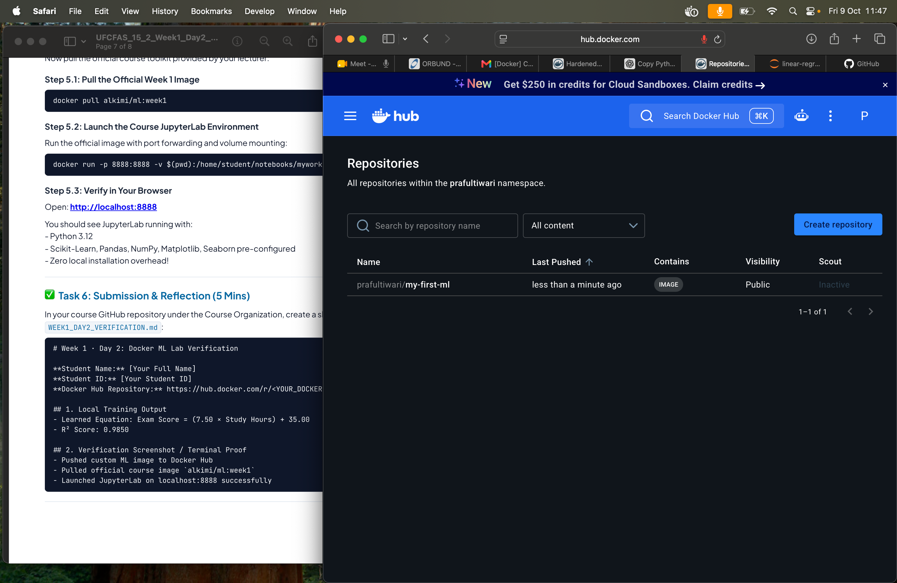

# Week 1 · Day 2: Docker ML Lab Verification
**Student Name
:** [Your Full Name]
**Student ID:** 11655
**Docker Hub Repository:** https://hub.docker.com/r/prafultiwari/my-first-ml
## 1. Local Training Output
- Learned Equation:Exam Score = (7.50 × Study Hours) + 35.00
- R² Score: 0.9850

## 2. Verification Screenshot / Terminal Proof
- Pushed custom ML image to Docker Hub

- Pulled official course image `alkimi/ml:week1`

- Launched JupyterLab on localhost:8888 successfully

